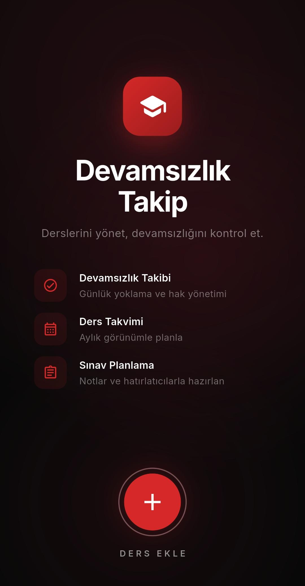
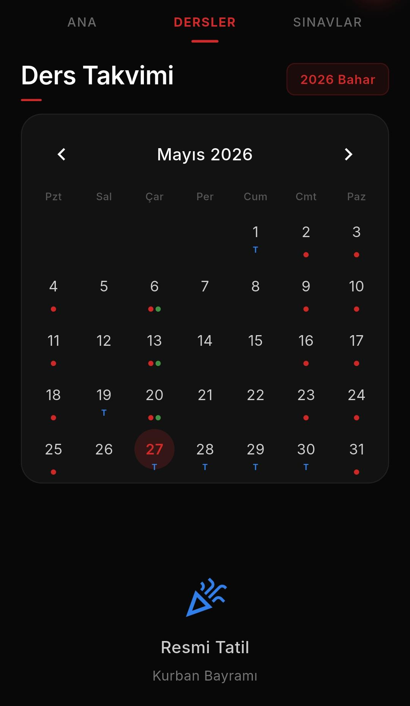

# 📱 Mobile Attendance Tracking Application

An Android mobile application developed for students to easily track their course attendance, absenteeism limits, and class schedules from a single place.

---

## 📸 Screenshots

| Schedule / Calendar | Course Details & Attendance |
| :---: | :---: |
|  |  |

---

## ✨ Key Features

* 📅 **Class Schedule & Calendar:** Visually track course days and hours.
* 📊 **Attendance Tracking:** Real-time calculation of remaining and used attendance allowances.
* 🎯 **User-Friendly Interface:** Clean, fast, and modern Flutter UI design.

---

## 🛠️ Tech Stack

* **Framework:** Flutter
* **Language:** Dart
* **Target Platform:** Android